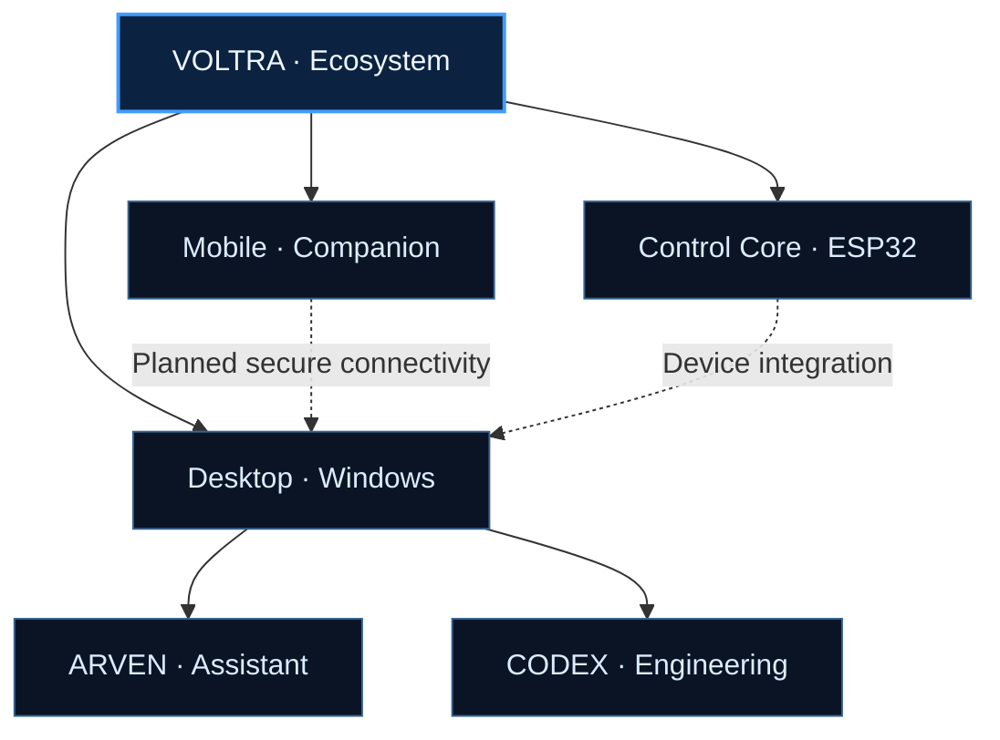

  

  <h3>ENGINEERED INTELLIGENCE</h3>

 

**An evolving intelligent ecosystem for connected software, interfaces, and hardware.**

[Explore Architecture](#03--system-architecture) · [Meet the Systems](#02--the-ecosystem) · [Roadmap](#06--development-roadmap)

---

## 01 / THE VISION

> **Technology should feel connected, responsive, and intentional.**

VOLTRA is an independent engineering project exploring a unified experience across Windows, mobile interfaces, intelligent assistants, and embedded control devices.

Its direction combines expressive interaction with modular software and hardware design.

<table>
<tr>
<td width="33%" valign="top">

### ◇ INTELLIGENCE

Context-aware interaction concepts, assistant workflows, and engineering support.

</td>
<td width="33%" valign="top">

### ◇ PRESENCE

An interface designed to feel responsive without unnecessary visual noise.

</td>
<td width="33%" valign="top">

### ◇ CONNECTION

A shared direction for desktop, mobile, and embedded experiences.

</td>
</tr>
</table>

---

## 02 / THE ECOSYSTEM

| COMPONENT | ROLE | DIRECTION |
|:--|:--|:--|
| **ARVEN** | Primary assistant | Voice, context, presence, and interaction |
| **CODEX** | Engineering agent | Coding workflows and technical assistance |
| **VOLTRA DESKTOP** | Windows experience | Local interaction and system controls |
| **VOLTRA MOBILE** | Companion interface | Connected access and remote interaction |
| **CONTROL CORE** | Embedded interface | ESP32-based touch control experiments |

> **Development note:** These describe the project's intended ecosystem. Individual features may be prototypes, incomplete, or planned.

---

## 03 / SYSTEM ARCHITECTURE

---

## 04 / ENGINEERING STACK

---

## 05 / PROJECT SHOWCASE

**Visual demonstrations and screenshots will appear here as features are validated.**

<!-- Example after adding a real screenshot:

-->

---

## 06 / DEVELOPMENT ROADMAP

- [ ] Stabilize desktop startup, window behavior, and side-panel transitions
- [ ] Refine ARVEN presence, voice interaction, and interruption handling
- [ ] Integrate CODEX workflows within the main interface
- [ ] Develop secure desktop-to-mobile connectivity
- [ ] Expand and document ESP32 Control Core integration
- [ ] Add reproducible setup instructions, tests, and demos

Progress is tracked through repository commits and issues.

---

## 07 / GETTING STARTED

The project is under active development.

Until a reproducible installer and setup guide are published, inspect the repository structure and documentation before running local components.

**Repository:** [esd2014-byte/lift](https://github.com/esd2014-byte/lift)

---

## 08 / PROJECT PRINCIPLES

**Modular by design.** Components should remain understandable and independently testable.

**Security before remote control.** Connected capabilities should be authenticated, permissioned, and documented.

**Clarity over spectacle.** Motion and visual effects should communicate meaningful system states.

---

### V O L T R A

**DESIGNED TO CONNECT. BUILT TO EVOLVE.**

INDEPENDENT ENGINEERING PROJECT · EXPERIMENTAL SOFTWARE & HARDWARE

## ARVEN WEB

[**Open ARVEN Web — Private Preview**](https://arven-web-voltra.jollydrum64.chatgpt.site)

Explore ARVEN through bilingual documentation, an interactive architecture map, and a visual state Lab. This website is separate from VOLTRA's private desktop and device controls.

> **Access:** Owner-private review version. The link currently requires the site owner's signed-in account; it is not a public demo.
